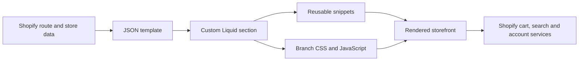

# NEXO

[← Project directory](https://github.com/Longspring2k/Shopify-Projects/tree/main)

> Source inspection based on commit `78469ff276244cc2820ebf3547e0111403075814`.

## Overview

A high-contrast catalogue storefront organized around custom home, search, collection, product and cart experiences.

This branch is a Shopify Online Store 2.0 theme. Shopify JSON templates select Liquid sections; those sections render store data and include reusable snippets; CSS and JavaScript in `assets/` provide the visual and interaction layer. The inspected branch has no package-manager build step.

## What is implemented

- A custom homepage section is wired for merchant-configurable content: [`NEXO/sections/studio-home.liquid`](NEXO/sections/studio-home.liquid).
- Search results have a custom route section in [`NEXO/sections/studio-search.liquid`](NEXO/sections/studio-search.liquid).
- Collection browsing uses [`NEXO/sections/studio-collection.liquid`](NEXO/sections/studio-collection.liquid) with reusable product-card rendering.
- Product presentation is implemented in [`NEXO/sections/studio-product.liquid`](NEXO/sections/studio-product.liquid) and receives Shopify product data through Liquid.
- A dedicated cart surface is present in [`NEXO/sections/studio-cart.liquid`](NEXO/sections/studio-cart.liquid); totals and checkout URLs still come from Shopify.
- JSON templates cover the principal storefront routes, including home, product, collection, cart and search.
- Standard theme files for predictive search, facets, customer pages and localization remain in the tree. Their presence does not establish that every feature is wired into the custom layout; runtime integration must be checked separately.

## Request-to-render flow

_Illustrative source architecture, not a runtime capture._

## Code map

- [`NEXO/sections/studio-home.liquid`](NEXO/sections/studio-home.liquid)
- [`NEXO/sections/studio-search.liquid`](NEXO/sections/studio-search.liquid)
- [`NEXO/sections/studio-collection.liquid`](NEXO/sections/studio-collection.liquid)
- [`NEXO/sections/studio-product.liquid`](NEXO/sections/studio-product.liquid)
- [`NEXO/sections/studio-cart.liquid`](NEXO/sections/studio-cart.liquid)
- [`NEXO/snippets/studio-card.liquid`](NEXO/snippets/studio-card.liquid)
- [`NEXO/assets/studio.css`](NEXO/assets/studio.css)
- [`NEXO/assets/studio-motion.js`](NEXO/assets/studio-motion.js)
- [`NEXO/templates/index.json`](NEXO/templates/index.json) — homepage routing.
- [`NEXO/templates/product.json`](NEXO/templates/product.json) — product route composition.
- [`NEXO/templates/collection.json`](NEXO/templates/collection.json) — collection route composition.
- [`NEXO/templates/cart.json`](NEXO/templates/cart.json) — cart route composition.
- [`NEXO/layout/theme.liquid`](NEXO/layout/theme.liquid) — outer Shopify document shell.
- [`NEXO/config/settings_schema.json`](NEXO/config/settings_schema.json) — theme-editor setting definitions.

## Route coverage

| Storefront route | Composition |
|---|---|
| Home | `templates/index.json` selects the custom landing section. |
| Collection | `templates/collection.json` renders collection data and product cards. |
| Product | `templates/product.json` renders media, variants, price and purchase controls. |
| Cart | `templates/cart.json` presents Shopify cart lines, totals and checkout handoff. |
| Search | `templates/search.json` selects a branch-specific custom results section. |
| Accounts and content | Standard customer, page, blog and article templates remain available. |

## Architecture notes

- **Rendering:** server-rendered Liquid, composed through Online Store 2.0 JSON templates.
- **Data:** Shopify `product`, `collection`, `cart`, `search`, localization and customer objects.
- **Presentation:** branch-specific sections and snippets layered over standard reusable theme components.
- **Interaction:** plain browser JavaScript from theme assets; no Node runtime is required in production.
- **Configuration:** section schemas and theme settings expose editable content in the Shopify theme editor.

## How this branch differs

Adds a branded search surface to the shared studio architecture and uses branch-specific templates to route the complete shopping path.

The branch should be evaluated as its own theme snapshot. Similar standard Shopify files appear across branches, but the custom sections, route coverage, stylesheet and visual hierarchy are branch-specific.

## Using the theme

The repository does not provide package scripts or a local build command. To preview it, use a Shopify development store and the Shopify CLI or upload the directory as a theme through Shopify's supported theme workflow. Select `NEXO` as the theme root.

Typical Shopify CLI commands are intentionally not asserted here because no CLI version or store configuration is pinned in this branch. Follow the commands for the Shopify CLI version installed in your environment.

## Verification status

This README was produced by static inspection of commit `78469ff276244cc2820ebf3547e0111403075814`. The files were **not runtime-tested**, uploaded, installed or connected to a store during documentation work.

## Platform and verification limits

- Screenshots, live catalogue content and merchant settings are not included as verification evidence.
- Product availability, prices, variants, media, collections, search results and cart totals require real Shopify store data.
- Checkout, payment, tax, shipping, customer authentication and order processing are Shopify-hosted platform capabilities, not implemented by this repository.
- Any placeholder copy or media visible in section defaults is demonstration content, not a claim about a live merchant.

## Credits and licensing

The branch contains standard Shopify theme building blocks alongside its custom presentation layer. No standalone license file was found in the inspected branch; reuse should therefore be reviewed with the repository owner before redistribution.
